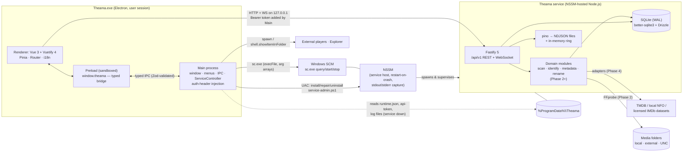

# 02 · Architecture

## 1. Overview



## 2. Components and ownership

| Component | Owns | Never does |
|---|---|---|
| **Service** (`apps/server`) | Database, scanning, metadata, artwork cache, settings, logs, service-event history, the HTTP/WS API | Show UI, launch players, open Explorer (it may run in another session) |
| **Desktop shell** (`apps/desktop`) | Window, native menu, native dialogs, service control (SCM + elevated admin), launching players/Explorer, injecting the API credential | Business logic, direct DB access |
| **UI** (`apps/ui`) | Presentation, interaction, focus/keyboard, i18n, theme | Node/Electron APIs (sandboxed), holding the API token |
| **Contracts** (`packages/contracts`) | Zod schemas and TS types for REST, WebSocket, IPC | — (shared, dependency-free) |
| **Logs** (`packages/logs`) | NDJSON writer/reader, rotation, pruning, data-path resolution — used by both the service and the shell so logs stay readable when the service is down | — |
| **Brand** (`packages/brand`) | SVG masters and generated PNG/ICO assets | — |

Repository layout:

```
apps/server    Fastify API + WS, SQLite, logging        → bundled to one CJS file (esbuild)
apps/ui        Vue 3 + Vuetify 4 SPA                     → static bundle served via app://theama
apps/desktop   Electron main + preload, service control  → bundled to out/main.cjs, out/preload.cjs
packages/contracts  packages/logs  packages/brand
tools/         dev launcher, NSSM fetch + elevated admin script
docs/          this documentation and ADRs
```

## 3. Service hosting: NSSM (ADR-0002)

The service is `node.exe server.cjs` wrapped by NSSM:

- **Auto-start (delayed)**, restart on exit after 5 s, throttle 15 s.
- **Graceful stop**: NSSM sends Ctrl+C → the server shuts down (records a `stop` event, closes SQLite). 20 s grace before escalation.
- **stdout/stderr** captured to `logs\service-stdout.log` / `service-stderr.log`, rotated at 5 MB.
- **Account**: chosen at install (current user, default; or Local System).
- **Permissions**: install sets an ACL on the service so the installing user can query/start/stop it without elevation; install/repair/uninstall are the only operations needing UAC.

Interactive actions (launch VLC, open Explorer, folder picker) are done by the **desktop shell**, never the service, because a service can run in a different session from the interactive desktop.

### Controller abstraction
`ServiceController` (`apps/desktop/src/main/service/controller.ts`) has two implementations:
- `NssmServiceController` — production; `sc.exe queryex/qc/start/stop`, plus the elevated admin script.
- `DevProcessController` — development/e2e; runs the server as a child process with the same start/stop/status semantics (graceful stop via a stdin message).

### Packaged layout (Phase 7)
`yarn dist` stages everything under `build/stage` (`tools/package/stage.mjs`) and electron-builder makes `build/installer/Theama-Setup-<version>.exe` (NSIS, per-machine, not signed). Installed, next to `Theama.exe`:

```
resources/app.asar          the desktop shell (main + preload bundles; no node_modules)
resources/ui/               the built interface (served over app://theama)
resources/server/server.cjs the backend bundle + server/node_modules/better-sqlite3 (JS + the win32-x64 prebuilt binary)
resources/node/node.exe     the Node.js that runs the service (the one the build ran with; VERSION.txt records it)
resources/nssm/             nssm.exe, service-admin.ps1 (install/repair/uninstall), installer-helper.ps1 (stop/start for upgrades)
resources/ffprobe/          ffprobe.exe + FFmpeg's licence and readme
resources/THIRD-PARTY-NOTICES.txt, icon.ico
```
User data stays in `%ProgramData%\Theama` (database, backups, logs, secrets, artwork cache), so upgrades and uninstalls never touch it unless the person asks. `THEAMA_CONTROLLER=process` runs the packaged Node + server as a plain child of the app (no Windows service); it is what the packaged smoke test uses.

## 4. Local trust model

Threats considered: a malicious **web page** calling `http://127.0.0.1:<port>`; **DNS rebinding**; another **local process under the same user**; another **Windows user** on the machine.

| Control | Defends against |
|---|---|
| Bind to `127.0.0.1` only | Network exposure |
| Per-install random **API token** (32 bytes) required as `Authorization: Bearer` on REST **and** WebSocket | Web pages and other users (a page cannot read the token) |
| **Host header** must be loopback | DNS rebinding |
| **Origin allowlist** (`app://theama`, plus the Vite origin in dev) and CORS restricted to it | Cross-site requests from browsers |
| Token stored in `%ProgramData%\Theama\secrets` with an ACL limited to SYSTEM, Administrators and the installing user | Other Windows users |
| Renderer sandboxed, `contextIsolation`, no Node, strict CSP, navigation and `window.open` blocked, permission requests denied | Renderer compromise escalating to the OS |
| Main process injects the token only into requests to the backend's exact port; renderer never sees it | Token theft via XSS |
| IPC: fixed channel list, Zod validation, sender-origin check; `openPath` refuses relative/traversal/device paths and executable types | Abuse of the bridge |
| `execFile` with argument arrays everywhere; elevated script accepts a fixed verb set and validated parameters | Shell injection |

**Residual risk (documented, accepted):** malware running as the same Windows user can read the token file and call the API. That is outside what a single-user local app can prevent.

## 5. Data directory

`%ProgramData%\Theama\` (override with `THEAMA_DATA_DIR`; dev uses `.dev-data/` in the repo):

```
data\theama.db          SQLite (WAL)         cache\     artwork & thumbnails (Phase 2+)
logs\theama-YYYY-MM-DD-NNN.ndjson            logs\service-stdout.log / service-stderr.log
secrets\api-token       runtime.json  (port, pid — written at start, removed on clean stop)
```
Nothing mutable lives in the install directory, so upgrades never touch user data.

## 6. Startup / runtime sequence

1. Service starts → opens DB (WAL, FK on) → applies pending migrations → records `crash` if the last event was an unmatched `start` → creates/loads token → listens on `127.0.0.1:47890` (falls back to a free port) → writes `runtime.json` → records `start`.
2. Desktop shell starts → reads `runtime.json` + token (ignoring a stale file whose pid is dead) → opens the UI → polls service status every 4 s and pushes changes to the UI and native menu.
3. UI resolves the endpoint through the bridge → `GET /health` → opens the WebSocket (heartbeat every 5 s; 12.5 s silence = reconnect) → on loss shows the recovery screen after a 1.5 s grace.

## 7. Desktop-only vs future-LAN features

| Desktop only (needs the shell) | Could be exposed through a secured LAN interface later |
|---|---|
| Service install/start/stop, folder picker, launching external players, opening Explorer, file rename UI that needs native confirmation | Browsing, search, details, collections, watched state, metadata views, log viewing (read-only) |

A LAN mode would need its own authentication (paired devices), TLS, and an explicit opt-in; none of that exists or is implied by the loopback token.

## 8. Changes from the brief (and why)
| Brief | Decision | Reason |
|---|---|---|
| Vuetify 3 | **Vuetify 4.2** | Current major; still Vue 3. ADR-0005 |
| Drizzle ORM + migrations | Drizzle for queries; **hand-written SQL migrations** embedded in code, with a test guarding drift | Survives bundling into one file; no codegen step. ADR-0003 |
| "Windows Service wrapper" | **NSSM** (user decision) | ADR-0002 |
| Tray icon (planned in earlier notes) | **Not built**: closing the window quits the UI and the service continues, so a tray adds nothing yet | Revisit with a "run in tray" setting |
