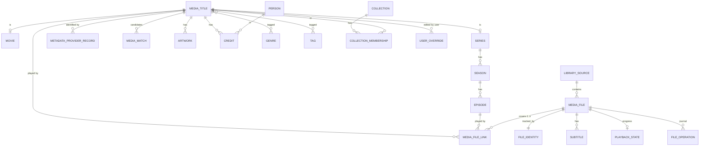

# 03 · Domain model and database

SQLite (WAL, `foreign_keys=ON`, `busy_timeout=5000`) via better-sqlite3; Drizzle ORM for typed queries; forward-only SQL migrations (`PRAGMA user_version`) applied at startup inside a transaction. A database written by a *newer* build is refused rather than downgraded.

## 1. What exists today (migrations 1–2) — **Built**

| Table | Purpose |
|---|---|
| `application_setting(key PK, value JSON-text, updated_at)` | Settings as key/value so adding a setting never needs a migration. Invalid stored values fall back to defaults per key. |
| `service_event(id, time, kind, reason, pid, version)` | start / stop / crash / restart / migrate history. Index on `time`. |
| `library_source(id, path UNIQUE, library_type, recursive, enabled, volume_id, availability, last_seen_online_at, created_at)` | Media folders. `volume_id` + `availability` exist now so offline drives are modelled before scanning is. |
| `scan_job(id, source_id → library_source ON DELETE CASCADE, status, started_at, finished_at, diagnostics, summary)` | Persisted scan runs; `summary` is JSON counters (found, new, changed, moved, missing, skipped, probed, errors), `diagnostics` a JSON list of notes. |
| `media_file(id, source_id → library_source ON DELETE CASCADE, path, size, mtime_ms, volume_id, file_id, state, first_seen_at, last_seen_at, missing_since, kind, guessed_title/year, season, episode, episode_end, episode_title, probe columns…)` | One row per discovered video. `state` is stored as `available` or `missing_unconfirmed`; **`source_offline` is derived at query time** from the folder's availability, so unplugging a drive writes nothing. `file_id` is the NTFS file id (rename/move detection). Parse columns are guesses from the file name and are recomputed on every scan; probe columns come from FFprobe. Unique on `(source_id, path COLLATE NOCASE)`. `kind` is `movie`, `episode`, `video` or `extra`. |

A test (`schema-drift.test.ts`) fails if the Drizzle declarations and the migrated tables disagree on names, nullability or primary keys.

### Title grouping and search (migration 3) — **Built**
- `media_file.title_key` groups files into titles until Phase 4 matches them to real ones: `series:<normalised title>` (all episodes of a show), `movie:<normalised title>:<year>`, and one key per personal video / extra. *Normalised* = lower-case, accents removed (Greek tonos too), punctuation dropped, final sigma folded, so `X-Men '97`, `X-Men 97` and `x-men 97` are one series.
- `media_file_fts` is a contentless FTS5 index (titles, episode titles, path words). Its text is **folded by the application, not by SQLite**, because SQLite's `remove_diacritics` does not touch Greek accents (found by test: `ταινια` did not match `Ταινία`). The repository maintains it on every insert/update; deletes (including cascades from removing a folder) are done by a SQL trigger; `ensureSearchIndex()` rebuilds it at startup if it ever disagrees with the table.

### Metadata tables (migration 4) — **Built**
- `title_match(title_key PK, kind, state matched|ambiguous|unmatched, provider, external_id, score, signals, candidates, decided_by auto|user, locked, attempts, attempted_at, updated_at)` — the decision. A locked row is only replaced by another decision from the user; clearing a match writes an `unmatched`, user-decided, locked row so Theama leaves the title alone.
- `title_metadata(title_key PK, provider, external_id, language, title, original_title, year, tagline, overview, runtime_min, genres, rating, votes, poster_path/poster_file, backdrop_path/backdrop_file, cast_json, imdb_id, status, fetched_at)` — what the provider said. A rating is only ever displayed with its provider's name. `*_path` keeps the provider-relative image path so artwork that failed to download is fetched later; `*_file` is the cached file.
- `episode_metadata(title_key, season, episode PK, name, overview, air_date, runtime_min, still_path, still_file)`.
- Provider data never overwrites what the files say: the library list shows the provider's title when there is one, and falls back to the name guessed from the files when a match is cleared. Rows for titles that no longer have any file are removed at start-up unless the user locked them.
- The full-text index gained a fourth column (`meta_text`: provider title and original title), so a title is found by its real name as well as by its file name, with the same accent- and case-folding. The migration recreates the (contentless) index empty and the server refills it on start.
- Artwork lives in `<cache>/artwork/` as `poster-…`, `backdrop-…`, `still-…`, `thumb-…` files named after the provider path. File names are validated on write and on read; the API serves them with `Cache-Control: immutable`.

### Collections (migration 5) — **Built**
- `collection(id, kind official|user, provider, external_id, name, overview, poster/backdrop path+file, fetched_at, created_at, updated_at)`; one official row per `(provider, external_id)`.
- `collection_member(id, collection_id → collection ON DELETE CASCADE, title_key, external_id, title, year, release_date, overview, poster path+file, custom_order)`.
  - **Official members** are the provider's movies (`external_id`), stored whether or not the library has them. Whether one is *local* is decided **when reading**: it is local if a matched movie title has that provider id and still has files. So identifying a title later links it with no extra step and no provider request, and an official set is listed only while at least one member is local. The provider's list replaces the stored one each time the set is read (at most every 30 days, or when a member movie is refreshed by hand).
  - **User members** are library titles (`title_key`), with the name and year they had when added. If the files disappear the member stays, shown as a non-playable entry; it can still be removed or reordered.
  - Orders: official sets are shown in release order; user collections in the person's own order (default) or release order. `story_order` is **not stored at all**: Theama has no curated data for it and never infers one.
  - Deleting a user collection removes memberships only. Official collections cannot be edited or deleted.
- `title_metadata` gained `collection_external_id` and `version`. Rows written by an older build have `version` 1 and are refreshed in the background, which is how data picks up fields added later. A movie whose collection could not be read yet counts as stale, so it is retried.

## 2. Target model (Phases 5–6) — **Designed** (the parts above are built; the rest is still design)

`media_file` above is the first piece of this model. Phase 4 keeps matches keyed by `title_key` (see above); `media_title` and a link table can replace that key later without discarding rows.

### Key decisions
1. **Title identity ≠ file identity.** `media_title` (a movie, a series, or a personal video) is independent of `media_file` (a physical path). A link table connects them, so:
   - one movie can have several files (cuts, qualities);
   - one file can cover several episodes (`S02E03-E04`);
   - files can be moved/renamed/replaced without losing the title, its metadata, collections or progress.
2. **File identity** (`file_identity`) stores volume serial + NTFS file ID (+ size and a cheap content fingerprint) so a rename or move on the same volume is recognised as the same file instead of delete + add.
3. **Provider data is separate and attributed.** `metadata_provider_record(title_id, provider, external_id, fetched_at, payload, language)` — a title can have TMDB + IMDb + local NFO ids. Ratings are stored per provider with vote counts and are **never labelled as IMDb unless they came from IMDb**.
4. **Override layering** (highest wins): `user_override` → local NFO (when configured) → cached provider data → filename-derived. Provider refreshes write only to the provider layer, so user edits survive rescans and refreshes. A *locked* `media_match` is never replaced automatically.
5. **Collections**: `collection(kind: official | sequel_chain | universe | user)` and `collection_membership(collection_id, title_id, release_order, story_order NULL, custom_order NULL)`. `story_order` is only populated from curated data — never inferred. A title may belong to many collections. Missing members are stored as *contextual* provider entries (no file) and never rendered as playable.
6. **Playback state** is per file (and rolled up per title/episode): `position_seconds, duration_seconds, watched, last_played_at, source` (`manual` / `player:<name>`), because automatic progress cannot be assumed for every external player.

## 3. Media availability (absent media) — **Designed**, columns **Built**

```mermaid
stateDiagram-v2
  [*] --> available: file seen on online source
  available --> source_offline: volume unreachable / volume id mismatch
  source_offline --> available: volume back, file present
  available --> missing_unconfirmed: source online, file not found
  missing_unconfirmed --> available: file reappears (or rename detected)
  missing_unconfirmed --> removed: user confirms OR grace period elapsed
  removed --> [*]: only the file link is dropped; title, metadata, overrides, progress remain
```

Rules:
- A source's availability is decided by the **source**, not by individual files. If the root is unreachable (or its volume serial differs from the one recorded when the source was added), **every file under it becomes `source_offline` and nothing else changes**. This is what makes an unplugged external drive harmless.
- `missing_unconfirmed` only applies when the source is online; it needs a user confirmation or a configurable grace period (default 30 days) before `removed`.
- The volume serial is read with `fs.stat().dev` (Windows volume serial); no marker files are ever written to the user's drives.
- Titles whose every file is offline are still returned by the API with `availability: offline` and `offlineReason`, so the UI can dim them and disable Play.

## 4. Delete behaviour and integrity
| Action | Effect |
|---|---|
| Remove a library source | Deletes its `scan_job` rows (cascade) and unlinks its files; **never touches files on disk**; titles keep metadata/overrides/progress and become "no files". |
| File vanishes | State change only (see §3). |
| Delete a user collection | Removes memberships only. |
| Delete a title (explicit user action) | Cascades to credits-links, artwork rows, matches, overrides, memberships; cached image files are removed by the cache janitor. |

All relations use real foreign keys with explicit `ON DELETE` rules; `foreign_keys` is on for every connection.

## 5. Indexes and search (planned)
- `media_file(source_id, path)` unique; `media_file(state)`; `file_identity(volume_id, file_id)`; `episode(season_id, number)`; `collection_membership(title_id)`; `playback_state(last_played_at DESC)`.
- Search: FTS5 virtual table over title, original title, alternate titles, episode titles, people, genres, tags, collections, year, overview. `unicode61 remove_diacritics 2` tokenizer so Greek accented/unaccented forms match. FTS5 is present in the bundled SQLite (verified: SQLite 3.53 from better-sqlite3 13).
- Lists use keyset (cursor) pagination; nothing loads the whole library into memory.

## 6. Migrations policy
Append-only list in `apps/server/src/db/migrations.ts`; never edit a released migration. Each runs in a transaction and bumps `user_version`. Backups (Phase 7) copy the DB with SQLite's backup API, not a file copy of a live WAL database.
