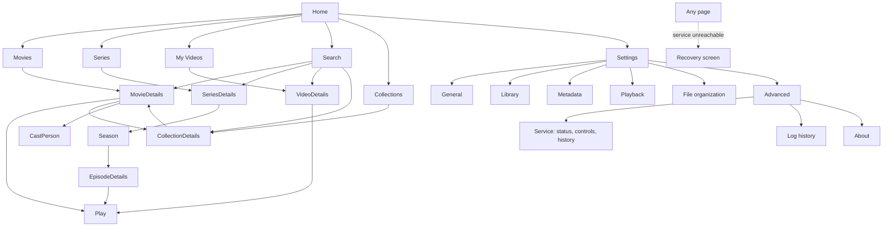

# 05 · UX and navigation

Navigation is the primary experience: the app should feel like a personal cinema, not an admin dashboard.

## 1. Navigation map

| Pattern | Desktop (≥ 960 px) | Narrow / mobile (< 960 px) |
|---|---|---|
| Primary nav | Horizontal themed window bar: brand, all primary destinations and connection status; native window controls remain at the right | Top app bar (logo + connection chip) and **bottom navigation**: Home, Movies, Series, My Videos, Search; Collections and Settings live under a "more" menu |
| Settings | Section list on the left, content on the right | Section list becomes a horizontal scroller above the content |
| Details | Hero with backdrop, side-by-side layout | Stacked, thumb-reachable primary action |
| Hover actions | Quick details + play + more on hover **and** focus | Never hover-dependent; actions always reachable by tap |

Implemented: desktop horizontal navigation integrated with themed window controls, mobile bottom navigation and app bar, settings layout, recovery screen, **Home rails, poster grids for Movies / Series / My Videos, title details (movies and series with seasons), and Search**. Media browsing pages expand to 1800 px so wide windows show more cards. Posters are generated placeholders until Phase 4 brings real artwork.

## 2. Screen specifications

**Home** — rails in order: Continue Watching · Recently Added · Movies · Series · Your Collections · Unwatched · Recently Released · Highly Rated · Favorites. Every title is local. A rail with no items disappears; an empty library shows the welcome empty state with "Add a folder". *(Built: empty state.)*

**Movies / Series / My Videos** — poster grid with filters (genre, year, rating, watched, resolution, language, tags, collection, recently added, **availability**), sort (title, release date, date added, rating, runtime, recently watched, file size), filter + sort in the URL, scroll/focus restored on return. Offline titles are dimmed with a badge. *(Built: empty states.)*

**My Videos** — never auto-matched. Custom title/description/tags/thumbnail, date recorded, folder grouping, favourites. Folder type is always user-overridable (Movies / Series / My Videos / Auto-detect).

**Search** — focus the field on open; debounced, grouped results (titles, series, episodes, people, genres, tags, collections), keyboard-navigable, recent searches in local storage. *(Built: route + field + empty state; indexing is Phase 3.)*

**Notification area (built).** Settings → General → *Desktop app*: *Keep Theama in the notification area when I close the window* (the close button hides the window; the tray icon's click or *Open Theama* brings it back; *Quit* in the tray really quits; the tray's tooltip and menu name the service's state) and *Start Theama when I sign in to Windows* (starts to the tray if the first option is on; only the installed app can register this). The background service runs whichever you choose. **Log detail** (Errors only / Warnings and errors / Normal / Detailed) changes how much the service logs at once; a level set in the environment wins over it.

**Accessibility (built, audited).** Every page and dialog is audited with axe-core in both themes and both languages (`apps/desktop/e2e/a11y.spec.ts`). Things it found and that are now rules of the app: navigation lists hold links, so they are not marked as lists; a card's accessible name contains its visible words (the generated poster's words are painted with CSS, not written into the page, and small badges are painted from `data-text`); a button's name starts with its visible text ("This one: Doctor Who 2005"); every select has a name; on the light theme secondary text uses 72 % emphasis (Vuetify's 60 % was 3.5:1 on the warm paper colour).

**Backup (built).** Settings → Advanced → Backup: *Back up now*, a list of backups (made by you, daily, before an upgrade, before a restore) each with *Restore* and *Delete*, *Restore from a file…* (native picker), *Open the backups folder*. Restoring explains what will be replaced, stages the restore, and shows a banner with *Restart now* (the app restarts the service itself) or *Cancel the restore*. Settings → Advanced → About has *Copy diagnostics report*. The window remembers its size, place and maximised state (and ignores a saved place that is no longer on any screen).

**Playing (built).** The title page's primary button is real: a film's best available file, or a series' *next episode* ("Play S01E02"; "Play again" once everything is watched), with a ▾ to choose a player for this one start. Episode rows have a play button and a watched toggle; a *Watched…* menu marks the title or the current season. Greyed with the reason when the drive is offline, and in a plain browser tab (only the desktop app can start a player). Cards of fully watched titles carry a check; Home starts with a *Continue watching* rail ("Next: S02E03"). File details list audio tracks and subtitles (inside the file and beside it), marking the one that would be used. **Rename files…** on a film or series opens a dialog: template, a row per file (subtitles indented under their video), checkboxes, status chips for anything that will not be renamed and why, then a result with **Undo**.

**Movie details** — backdrop hero, poster, title/original title/year, rating (provider-labelled), runtime, genres, **one obvious primary CTA** (Play / Continue / "Unavailable — drive offline"), synopsis, cast carousel, collection associations, similar local titles, technical info, subtitles, file actions.

**Series details** *(built, except watched state and the next-episode CTA, which need playback state)* — season tabs with a local count and a "N missing" chip, a season summary line ("3 expected · 2 in your library · 1 missing"), and one list per season: files (expandable, with the provider's name, description and still) and **gaps** — dashed rows that are never buttons: *Missing* (aired, no file), *Airs 2099-01-01* (not yet aired), *No air date* (cannot tell). An episode (or film) with several files is listed once, with a **Switch path** button that opens the list of paths so the person can pick the file Play uses; the choice is remembered on this device; files the provider does not list carry "Not in TMDB's list" and stay in their season; files with no number go under *Unnumbered*. Specials are their own tab and never counted as missing. Series cards in the list say "3 missing".

**Collections** *(built for official and user)* — a grid of collection cards (filter: All / From TMDB / Mine; "2 of 4 in your library"), and a detail page per collection. Release order for official sets; "Release order" or "My order" for your own, which can be rearranged with earlier / later / remove buttons per title (no drag-and-drop yet). Members the library lacks are dashed, dimmed, labelled *Not in your library*, and are never links. Title pages list the collections a title is in ("Part of …") and have an **Add to collection** menu with *New collection…*. Story order and sequel/universe chains are not offered: they need curated data and are never guessed. Arrow keys move between the cards of a collections grid, a collection's titles, Home's collections rail and search results (each card stays a Tab stop). Collections also appear on **Home** (a rail) and in **Search** (a *Collections* group, matched on words of the name, accents and capitals ignored).

**Settings** — General (language, theme, log retention) *built* · Library *built* · **Metadata** *built* (TMDB key, language, progress, what is sent) · **Playback** *built* (players found on this PC, default, add a program, subtitle language order, what Theama can and cannot know about watching) · **File organization** *built* (name templates, rename history with Undo) · **Advanced → Service / Log history / About** *built*.

**Service & logs (built)** — Service: state chip, host kind, account, pid, API reachability, Start/Stop/Restart, Install/Repair/Uninstall with an account chooser and an elevation notice, start/stop/crash history. Logs: search, minimum level, source, time range, live tail switch, copy, open folder, virtualised list with entry detail dialog, "load older".

**Recovery (built)** — shown after the backend has been unreachable for 1.5 s: plain-language cause (not installed / stopped / starting / running but silent / dev process), Start or Install, Check again, and the latest log lines read from disk.

## 3. Focus and keyboard strategy

Global shortcuts (implemented in `useGlobalShortcuts`):

| Keys | Action |
|---|---|
| `/` or `Ctrl+F` | Open search (`/` ignored while typing in a field) |
| `Alt+←` | Back |
| `Backspace` / `Esc` | Back, **only** when no field is focused and no dialog/menu is open |
| `Ctrl+1…5`, `Ctrl+,`, `Ctrl+Shift+L` | Sections, settings, log history |
| `Tab` / `Shift+Tab` | Standard focus order; every control has a visible focus ring (2 px bronze, offset) |

Rails and grids (**built**): each rail or grid is one tab stop; `←/→` move within it, `↑/↓` move between rails keeping the column index, `Enter` opens, `Space` plays when a play action exists. Grids use `←/→/↑/↓`, `Home/End`, `PageUp/PageDown` (Down from a short last row lands on the last card). Returning with Back / Alt+←/ Esc restores the list, scroll position and focused card; opening a page fresh from the top navigation does not (the router tells us which it was). Esc/Backspace from a details page returns to the list. Down from the search box jumps into the first result.

**Identification (built).** Cards show the provider's poster once a title is identified (the generated poster stays until the image has loaded, and if it never does). A small `?` marks titles Theama could not settle; the card's accessible name says *Not identified*. The title page shows a banner for *ambiguous* ("Which one is this?" → **Choose**) and *unmatched* titles, a quiet line for matched ones ("Identified automatically using TMDB", with a *Locked* chip after a manual choice), and an **Identification** menu: *Change match…*, *Refresh details*, *Clear match*, *Unlock*. The **Identify** dialog starts from the name found in the files, searches straight away, and lists poster, title, year, original title and a three-line description per candidate; choosing one locks it. Home shows a dismissible card inviting the user to add a TMDB key while none is set.

Rules: overlays own `Esc`; focus moves into a dialog when it opens and returns to its trigger on close; live regions announce counts and status changes (`aria-live` on log count, empty states).

## 4. States
Every data surface defines loading, empty, error and success states. Implemented examples: connecting splash (before first connection), recovery screen (backend down), per-page empty states, settings saved snackbar, log list empty / error / end-of-history.

## 5. Accessibility
Landmarks (`nav` with labels, `main`), real buttons/links, labelled toggles, contrast-checked token pairs (see 06), reduced-motion honoured globally, no hover-only essentials, Greek and English strings are complete (an automated test enforces key parity and that every used key exists).
