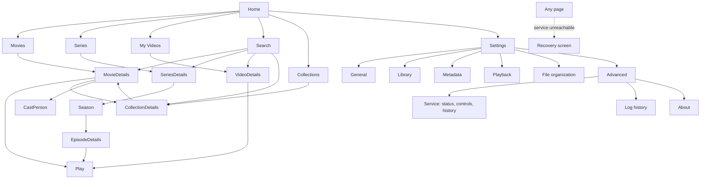

# 05 · UX and navigation

Navigation is the primary experience: the app should feel like a personal cinema, not an admin dashboard.

## 1. Navigation map

| Pattern | Desktop (≥ 960 px) | Narrow / mobile (< 960 px) |
|---|---|---|
| Primary nav | Persistent left sidebar: Home, Movies, Series, My Videos, Search, Collections; Settings + connection status pinned to the bottom | Top app bar (logo + connection chip) and **bottom navigation**: Home, Movies, Series, My Videos, Search; Collections and Settings live under a "more" menu |
| Settings | Section list on the left, content on the right | Section list becomes a horizontal scroller above the content |
| Details | Hero with backdrop, side-by-side layout | Stacked, thumb-reachable primary action |
| Hover actions | Quick details + play + more on hover **and** focus | Never hover-dependent; actions always reachable by tap |

Implemented: sidebar, bottom navigation, app bar, settings layout, recovery screen. The rest are specified below and built in later phases.

## 2. Screen specifications

**Home** — rails in order: Continue Watching · Recently Added · Movies · Series · Your Collections · Unwatched · Recently Released · Highly Rated · Favorites. Every title is local. A rail with no items disappears; an empty library shows the welcome empty state with "Add a folder". *(Built: empty state.)*

**Movies / Series / My Videos** — poster grid with filters (genre, year, rating, watched, resolution, language, tags, collection, recently added, **availability**), sort (title, release date, date added, rating, runtime, recently watched, file size), filter + sort in the URL, scroll/focus restored on return. Offline titles are dimmed with a badge. *(Built: empty states.)*

**My Videos** — never auto-matched. Custom title/description/tags/thumbnail, date recorded, folder grouping, favourites. Folder type is always user-overridable (Movies / Series / My Videos / Auto-detect).

**Search** — focus the field on open; debounced, grouped results (titles, series, episodes, people, genres, tags, collections), keyboard-navigable, recent searches in local storage. *(Built: route + field + empty state; indexing is Phase 3.)*

**Movie details** — backdrop hero, poster, title/original title/year, rating (provider-labelled), runtime, genres, **one obvious primary CTA** (Play / Continue / "Unavailable — drive offline"), synopsis, cast carousel, collection associations, similar local titles, technical info, subtitles, file actions.

**Series details** — season selector, episode grid/list with watched state, season summary ("Season 2 — 10 expected, 8 local, 2 missing"), next-episode CTA. Missing ≠ unaired ≠ unknown-to-provider, each visually distinct.

**Collections** — official / sequel chain / universe / user, three orderings (release, story where curated, custom). Missing members shown as clearly labelled non-playable entries.

**Settings** — General (language, theme, log retention) *built* · Library · Metadata · Playback · File organization (placeholders, clearly marked "coming in a later release") · **Advanced → Service / Log history / About** *built*.

**Service & logs (built)** — Service: state chip, host kind, account, pid, API reachability, Start/Stop/Restart, Install/Repair/Uninstall with an account chooser and an elevation notice, start/stop/crash history. Logs: search, minimum level, source, time range, live tail switch, copy, open folder, virtualised list with entry detail dialog, "load older".

**Recovery (built)** — shown after the backend has been unreachable for 1.5 s: plain-language cause (not installed / stopped / starting / running but silent / dev process), Start or Install, Check again, and the latest log lines read from disk.

## 3. Focus and keyboard strategy

Global shortcuts (implemented in `useGlobalShortcuts`):

| Keys | Action |
|---|---|
| `/` or `Ctrl+F` | Open search (`/` ignored while typing in a field) |
| `Alt+←` | Back |
| `Backspace` / `Esc` | Back, **only** when no field is focused and no dialog/menu is open |
| `Ctrl+1…5`, `Ctrl+,`, `Ctrl+Shift+L` | Native menu accelerators: sections, settings, log history |
| `Tab` / `Shift+Tab` | Standard focus order; every control has a visible focus ring (2 px bronze, offset) |

Rails (Phase 3): the rail is one tab stop; `←/→` move within it, `↑/↓` move between rails keeping the column index, `Enter` opens, `Space` plays when a play action exists. Focus is remembered per rail; returning from a details page restores the focused poster and scroll offset (router `scrollBehavior` already restores scroll; focus restoration is added with the rails).

Rules: overlays own `Esc`; focus moves into a dialog when it opens and returns to its trigger on close; live regions announce counts and status changes (`aria-live` on log count, empty states).

## 4. States
Every data surface defines loading, empty, error and success states. Implemented examples: connecting splash (before first connection), recovery screen (backend down), per-page empty states, settings saved snackbar, log list empty / error / end-of-history.

## 5. Accessibility
Landmarks (`nav` with labels, `main`), real buttons/links, labelled toggles, contrast-checked token pairs (see 06), reduced-motion honoured globally, no hover-only essentials, Greek and English strings are complete (an automated test enforces key parity and that every used key exists).
