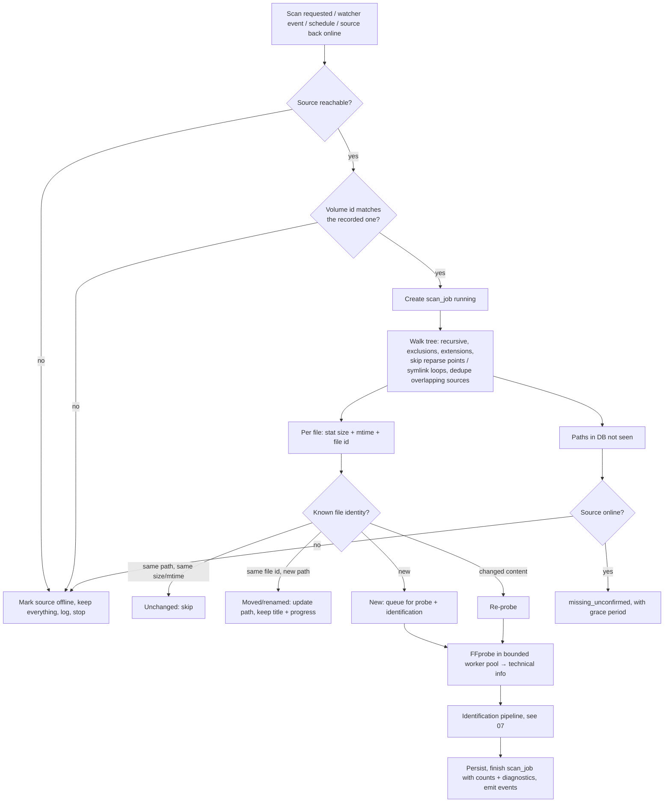

# 08 · Media scanning workflow (Phase 2) — **Designed**

Foundations already in place: `library_source` (with `volume_id`, `availability`, `last_seen_online_at`), `scan_job` (persisted status + diagnostics), job/progress channel (WebSocket), service-event and log infrastructure.

## 1. Flow

## 2. Incremental scanning
- A file is skipped when `(path, size, mtime)` match the last scan. Only new/changed files hit FFprobe and the matcher, which also keeps provider requests low.
- Probing and matching run in a **bounded worker pool** (default `min(4, cores-1)`), never on the Electron main process and never blocking the API event loop. Jobs are **cancellable** and **resumable**: progress is persisted, so a crash or reboot resumes instead of restarting.
- Progress is pushed over WebSocket (`scan.progress`: found / probed / matched / errors) and shown by `ScanProgressIndicator`.

## 3. Detecting add / remove / move / rename
- **Identity** = volume serial + NTFS file id (`fs.stat` `dev`/`ino` as BigInt) plus size. Same id on the same volume at a new path ⇒ **move/rename** (title, metadata, collections, progress preserved).
- Cross-volume moves have no stable id: fall back to (size + name-similarity + probe duration) and mark as *probable move* needing no user action only if unambiguous; otherwise the old file goes `missing_unconfirmed` and the new one is treated as new, and the user can merge.
- **Filesystem watcher** (`fs.watch` recursive on Windows) feeds a debounced queue (2 s quiet period) that triggers targeted rescans of the affected directories, never a full scan. Watchers are not relied upon for correctness: a periodic reconcile scan catches missed events (network shares, sleep/resume).

## 4. Offline media and disconnected drives
- **Reachability check before every scan**: root `stat`, then compare the root's volume serial with `volume_id`. An unreachable root **or a different volume mounted at the same drive letter** ⇒ source `offline`.
- When a source is offline nothing is deleted or downgraded. Its files keep their state; titles show dimmed with "Offline — drive E: disconnected" and Play disabled.
- **Coming back online** is detected by the watcher on the parent, a poll (30 s backoff to 5 min) and by device-change events; the source flips to `online`, an incremental scan runs, and the user gets a toast ("E: reconnected — 2 changes found").
- Only when a source is **online** and a file is absent does a file become `missing_unconfirmed`. It becomes `removed` only on user confirmation or after the grace period (default 30 days).
- Titles with several files play the available copy; the badge says "1 of 2 versions available".
- Disconnected network shares behave the same (timeouts bounded so a dead share cannot stall the scanner).

## 5. Safety rules
- Windows path handling: long paths (`\\?\`), Unicode (incl. Greek) names, case-insensitive comparison, trailing dots/spaces.
- **Overlapping sources** (`D:\Movies` and `D:\Movies\Marvel`) are detected on add; files are indexed once, attributed to the most specific source.
- **Symlink / junction / reparse-point loops** are not followed (`lstat` + visited-id set).
- **Permission denied / corrupt media / locked file** ⇒ per-file diagnostic in `scan_job.diagnostics`, the scan continues.
- Removing a source never touches files on disk.

## 6. Failure recovery
- Process killed mid-scan: on startup, `scan_job` rows still `running` are marked `interrupted` and resumed.
- DB locked: bounded retries with backoff (WAL + busy timeout already set).
- Probe failures: retried once, then recorded; the file remains listed with minimal info.
- Every scan writes a summary line to the log history, visible in Settings → Advanced → Log history.
