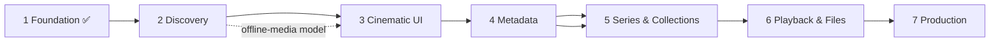

# 09 · Implementation roadmap

Dependency order: **contracts → server core → desktop shell → UI shell → discovery → UI browse → metadata → series/collections → playback/files → production.** Each phase leaves a runnable app.

## Phase 1 — Foundation ✅ (delivered)
| Task | Status |
|---|---|
| Yarn 4 workspaces monorepo, strict TS, ESLint, Vitest | ✅ |
| `contracts` (Zod: REST, WS, IPC, settings, logs, service) | ✅ |
| Server: Fastify, WS, SQLite + migrations, settings, token/Host/Origin security, logging, service-event history, graceful shutdown | ✅ |
| Desktop: sandboxed Electron, `app://` protocol, token injection, typed IPC, native menu incl. **Service menu**, localized menu strings, single instance | ✅ |
| **NSSM service management**: `NssmServiceController` (sc.exe), elevated `service-admin.ps1`, pinned NSSM fetch, account choice at install, non-elevated start/stop ACL, `DevProcessController` for development | ✅ code + unit tests · ⚠️ install path not exercised in a real UAC session (see 11) |
| **Media folders** (pulled forward from Phase 2): add/remove folders with the native picker, type per folder (Movies/Series/My Videos/Auto), subfolders, enable/pause, per-folder online/offline status (volume-aware), duplicate detection; no scanning yet | ✅ |
| UI shell: sidebar / bottom nav / app bar, 6 section pages with empty states, themes, EN/ΕΛ, settings, **Service page**, **Log history**, recovery screen | ✅ |
| Logo + icons (SVG masters → PNG/ICO) | ✅ |
| Tests: 485 unit/integration + 22 Electron e2e (incl. 5 accessibility) + 6 packaged-app smoke (Phases 1–8) | ✅ |

**Acceptance (brief):** Theama opens as a desktop app, talks to the backend, shows a functional shell — ✅ (e2e). **Added:** service manageable from the UI, logs browsable, recovery when the service is down — ✅.

## Phase 2 — Media discovery ✅ (delivered)
Delivered: scanner (incremental walk, rename/move detection, missing-file flagging, junction safety, nested folders), FFprobe (pinned download, bounded pool), filename parser (movies, `SxxEyy`/`NxNN`/multi-episode, anime numbering, release-group noise, extras, folder context), scan jobs with progress and cancel, automatic triggers and watchers, offline-source handling, and Movies / Series / My Videos listing the files. Verified against a real 131-file series folder (all grouped correctly in 0.1 s; 129 files probed in 3.2 s; 2 genuinely corrupt files reported as unreadable).

Original scope:
Scanner with incremental walk, exclusions, symlink safety, overlap detection · FFprobe (bundled, checksum-pinned, same pattern as NSSM) in a bounded worker pool · `media_title/media_file/file_identity` migrations · rename/move detection · **volume identity + offline-source handling and the file availability state machine (03/08)** · scan progress over WebSocket · library pages list local files (no external metadata).
*Acceptance:* user adds real folders and browses detected files; unplugging a drive dims its titles and deletes nothing; plugging it back reconciles.
*Depends on:* Phase 1.

## Phase 3 — Cinematic UI ✅ (first slice delivered)
Delivered: title grouping (one card per movie / series), generated poster artwork, poster cards with focus/hover states and availability badge, grids with infinite scroll and `content-visibility`, Home rails, details pages (movie facts; series with seasons and episode list, open-folder and copy-path), **FTS5 search** (Greek-aware, prefix, accent- and case-insensitive) with recent searches, keyboard navigation with focus and scroll restoration. Verified on a real series folder (121 files → 10 cards).
Not yet: real artwork and thumbnails (Phase 4), true list virtualisation for 5,000+ cards (currently paged + `content-visibility`), landscape cards / hero carousel, collections page.

Original scope:
`MediaPosterCard`, rails with keyboard model, details pages, FTS5 search + suggestions + recents, filters/sort in URL, navigation history with scroll/focus restoration, virtualised grids, locally generated thumbnails (FFmpeg frame grab) as artwork fallback, availability variant of cards.
*Acceptance:* pleasant and fast on a few thousand titles using local artwork only. *Depends on:* 2.

## Phase 4 — Metadata ✅ (first slice delivered)
Delivered: provider interface + TMDB adapter with spacing, retry/backoff/jitter, circuit breaker; matcher with thresholds and margin; automatic background identification (key set, scan finished, language changed, periodic); artwork cache served by the backend; titles, overview, tagline, genres, cast, runtime, rating with provider name, episode names/overviews/stills; per-field English fallback; manual identification dialog with locking, refresh, clear, unlock; Settings → Metadata; Greek-aware search over provider titles. Verified with a fake TMDB server (automated) and the real service's error shape; **not yet run with a real key.**
Not yet: local NFO provider, crew and person pages, runtime/sibling scoring signals, movie⇄series reclassification, collections metadata, refresh-all and scheduled refresh of old data.

Original scope:
Provider abstraction + TMDB adapter, matcher (07), artwork cache, cast/crew/genres/ratings with provenance, manual identification dialog, match locking, refresh. *Acceptance:* recognised titles are rich; unmatched files stay manageable. *Depends on:* 2 (3 for UI).

## Phase 5 — Series & collections ✅ (first slice delivered)
Delivered: per-episode coverage (local / missing / upcoming / undated, duplicates, unlisted files, multi-episode ranges, specials), season summaries and missing counts on cards and pages, background refresh of airing series; official collections from TMDB with contextual "not in your library" entries; user collections (create, rename, delete, add/remove, custom order, release order); "Part of" and *Add to collection* on title pages; versioned provider data that refreshes itself when a build stores more.
Not yet: story order / sequel chains / universes (need curated data), drag-and-drop ordering, episode groups / absolute numbering for anime, "excluded by filter" classification.

Original scope:
Series/season/episode model and episode detection (multi-episode, specials), missing-episode classification, continue-watching + next-episode rules, collections (official, sequels, universes, user; release/story/custom ordering; contextual missing entries). *Depends on:* 4.

## Phase 6 — Playback & file management ✅ (first slice delivered)
Delivered: players detected (VLC, MPC-HC, MPC-BE, mpv, PotPlayer, PATH) plus any program the person adds and the system default; started by the desktop shell with argument arrays (`--` before the file for mpv), never through a shell; subtitle chosen from the person's language order and passed to players that accept one; watched marks per file/episode/season/title; next-episode rule, Continue watching rail, watched check on cards; embedded and external subtitle detection with language; rename templates with preview, collisions (name taken, same name twice, path too long), in-place renames with their subtitles, an approved-pairs-only apply, a write-ahead journal, Undo, crash recovery.
Not yet: resume position and automatic watched tracking (needs per-player integrations: VLC web interface, mpv IPC); picking a subtitle file by hand; moving files into folders by template; refusing a rename while a player has the file open (Windows reports it as 'in use' and the item fails safely); bulk rename across the library from one screen; per-title player choice that is remembered.

Original scope:
External players (detect, configure, per-video choice, argument arrays only) executed by the **desktop shell**; open folder; copy path; subtitles (embedded + external, language, association); rename templates + preview + collision detection + **journalled, recoverable** operations + rollback; playback-state capabilities per player. *Depends on:* 2, 4.

## Phase 7 — Production readiness ✅ (first slice delivered)
Delivered: backup and restore (automatic daily and pre-upgrade copies, manual copies, restore from the list or a file, applied safely at the next start); an installer (electron-builder + NSIS, per-machine) with the bundled Node.js, backend, NSSM, FFprobe and notices, upgrade hooks that stop and restart the service, and an uninstaller that removes the service and asks before deleting data; a packaged-app smoke test; a performance pass against the budgets with fixes to two quadratic queries; local error reporting (interface and desktop errors in the log history, a copyable diagnostics report); window state; third-party notices.
Not yet: running the installer on a clean machine (needs an administrator's approval); code signing (SmartScreen will warn); automatic updates (electron-builder already writes the blockmap; a feed needs a host); tray icon and start-with-Windows; installer language selection (the installer is English); an accessibility audit with a screen reader.

Original scope:
Installer (electron-builder + NSIS) that: installs the app, bundles `node.exe` + `server.cjs` + `nssm.exe` + the admin script as resources, runs the **elevated** install (service + data dir ACLs), preserves data on upgrade (stop service → replace files → start), removes the service on uninstall with a keep/delete-data choice · auto-update strategy · backup/restore (SQLite backup API) · performance pass (budgets in 10) · error reporting (local only) · docs. *Acceptance:* clean Windows install can install, run, update, uninstall reliably.

## Phase 8 — Everyday polish ✅ (first slice delivered)
There was no eighth phase in the original plan; this one collects the cross-cutting backlog that could be finished and checked without anything from outside (a certificate, a host, a clean machine).
Delivered: an **automated accessibility audit** (axe-core, WCAG 2.0/2.1 A and AA) of every page and dialog, in both themes and both languages, with the problems it found fixed; **keep Theama in the notification area** (tray icon, close-to-tray, start with Windows to the tray); a **log detail** setting; **collections** on Home, in search, and arrow-key movement between cards; window state (Phase 7).
Not yet: a screen-reader pass by a person (the audit cannot judge reading order, wording or focus management as a whole); code signing; a tray menu with service actions (it shows the service state, Open and Quit); installer language; the original backlog items that need outside input (a certificate, an update host, a clean Windows VM).

## Cross-cutting backlog (what is left)
Signed binaries · automatic updates (needs a host) · a screen-reader pass · running the installer on a clean machine.
