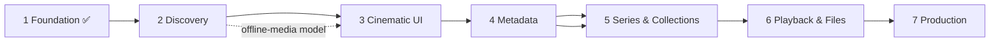

# 09 · Implementation roadmap

Dependency order: **contracts → server core → desktop shell → UI shell → discovery → UI browse → metadata → series/collections → playback/files → production.** Each phase leaves a runnable app.

## Phase 1 — Foundation ✅ (delivered)
| Task | Status |
|---|---|
| Yarn 4 workspaces monorepo, strict TS, ESLint, Vitest | ✅ |
| `contracts` (Zod: REST, WS, IPC, settings, logs, service) | ✅ |
| Server: Fastify, WS, SQLite + migrations, settings, token/Host/Origin security, logging, service-event history, graceful shutdown | ✅ |
| Desktop: sandboxed Electron, `app://` protocol, token injection, typed IPC, native menu incl. **Service menu**, localized menu strings, single instance | ✅ |
| **NSSM service management**: `NssmServiceController` (sc.exe), elevated `service-admin.ps1`, pinned NSSM fetch, account choice at install, non-elevated start/stop ACL, `DevProcessController` for development | ✅ code + unit tests · ⚠️ install path not exercised in a real UAC session (see 11) |
| **Media folders** (pulled forward from Phase 2): add/remove folders with the native picker, type per folder (Movies/Series/My Videos/Auto), subfolders, enable/pause, per-folder online/offline status (volume-aware), duplicate detection; no scanning yet | ✅ |
| UI shell: sidebar / bottom nav / app bar, 6 section pages with empty states, themes, EN/ΕΛ, settings, **Service page**, **Log history**, recovery screen | ✅ |
| Logo + icons (SVG masters → PNG/ICO) | ✅ |
| Tests: 134 unit/integration + 11 Electron e2e | ✅ |

**Acceptance (brief):** Theama opens as a desktop app, talks to the backend, shows a functional shell — ✅ (e2e). **Added:** service manageable from the UI, logs browsable, recovery when the service is down — ✅.

## Phase 2 — Media discovery
Scanner with incremental walk, exclusions, symlink safety, overlap detection · FFprobe (bundled, checksum-pinned, same pattern as NSSM) in a bounded worker pool · `media_title/media_file/file_identity` migrations · rename/move detection · **volume identity + offline-source handling and the file availability state machine (03/08)** · scan progress over WebSocket · library pages list local files (no external metadata).
*Acceptance:* user adds real folders and browses detected files; unplugging a drive dims its titles and deletes nothing; plugging it back reconciles.
*Depends on:* Phase 1.

## Phase 3 — Cinematic UI
`MediaPosterCard`, rails with keyboard model, details pages, FTS5 search + suggestions + recents, filters/sort in URL, navigation history with scroll/focus restoration, virtualised grids, locally generated thumbnails (FFmpeg frame grab) as artwork fallback, availability variant of cards.
*Acceptance:* pleasant and fast on a few thousand titles using local artwork only. *Depends on:* 2.

## Phase 4 — Metadata
Provider abstraction + TMDB adapter, matcher (07), artwork cache, cast/crew/genres/ratings with provenance, manual identification dialog, match locking, refresh. *Acceptance:* recognised titles are rich; unmatched files stay manageable. *Depends on:* 2 (3 for UI).

## Phase 5 — Series & collections
Series/season/episode model and episode detection (multi-episode, specials), missing-episode classification, continue-watching + next-episode rules, collections (official, sequels, universes, user; release/story/custom ordering; contextual missing entries). *Depends on:* 4.

## Phase 6 — Playback & file management
External players (detect, configure, per-video choice, argument arrays only) executed by the **desktop shell**; open folder; copy path; subtitles (embedded + external, language, association); rename templates + preview + collision detection + **journalled, recoverable** operations + rollback; playback-state capabilities per player. *Depends on:* 2, 4.

## Phase 7 — Production readiness
Installer (electron-builder + NSIS) that: installs the app, bundles `node.exe` + `server.cjs` + `nssm.exe` + the admin script as resources, runs the **elevated** install (service + data dir ACLs), preserves data on upgrade (stop service → replace files → start), removes the service on uninstall with a keep/delete-data choice · auto-update strategy · backup/restore (SQLite backup API) · performance pass (budgets in 10) · error reporting (local only) · docs. *Acceptance:* clean Windows install can install, run, update, uninstall reliably.

## Cross-cutting backlog
Window state persistence · "start with Windows / run in tray" setting · log-level setting · accessibility audit (screen reader pass) · signed binaries.
